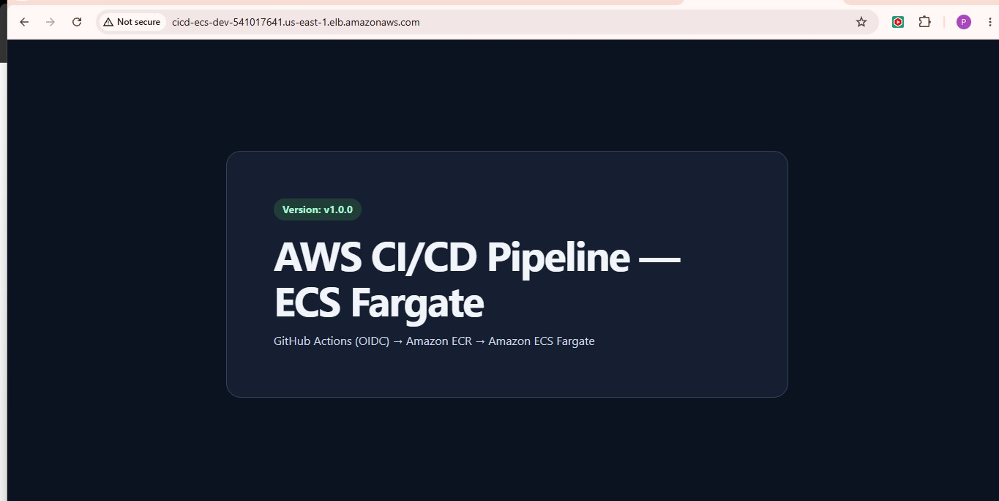
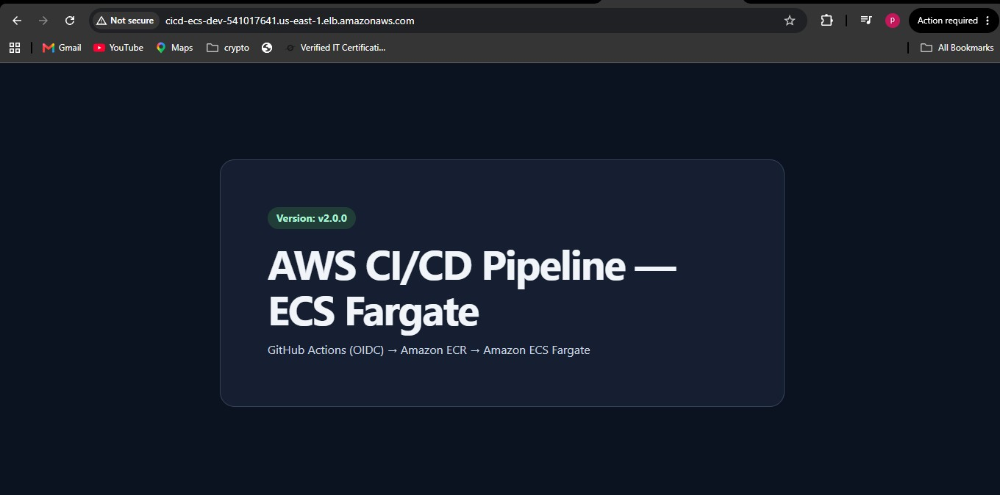
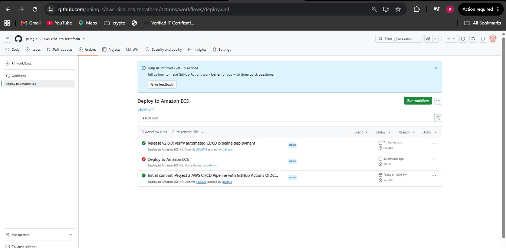
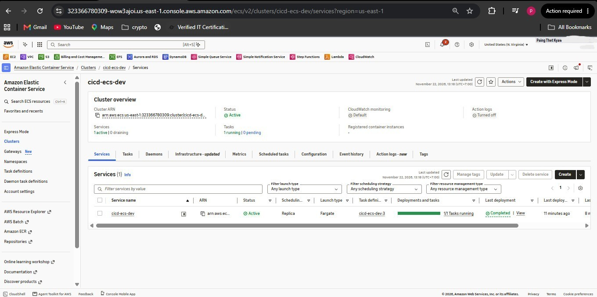
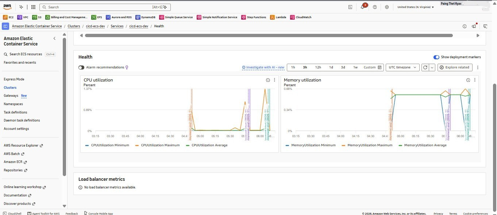
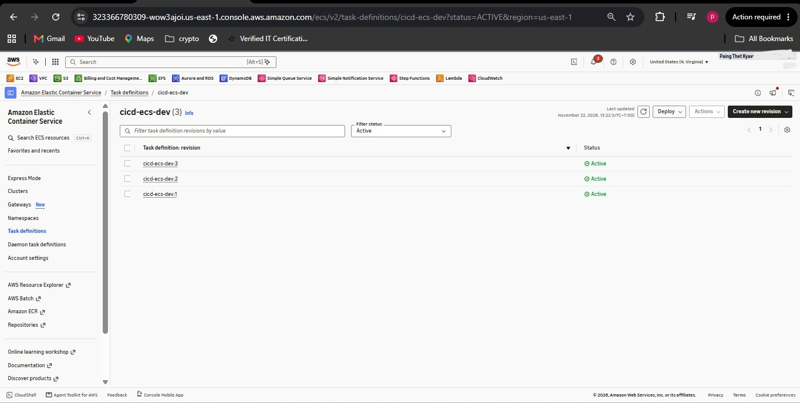
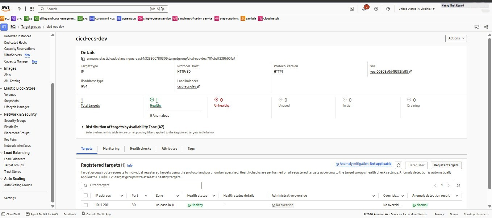
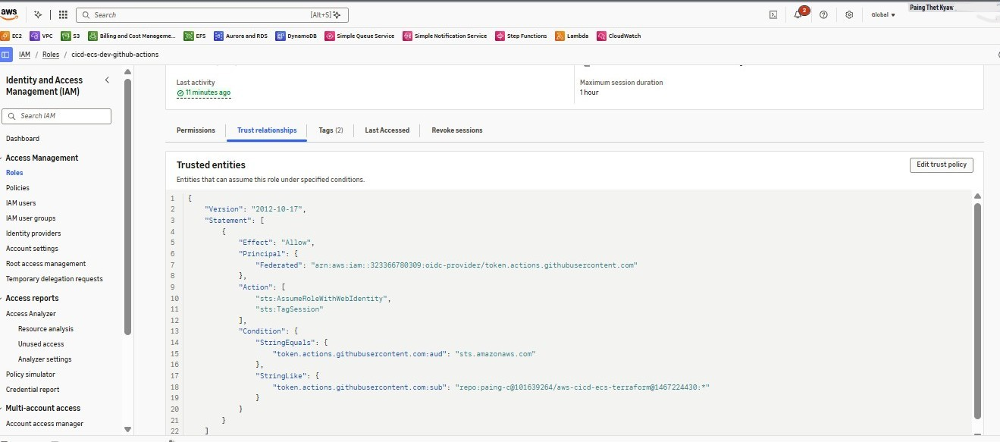
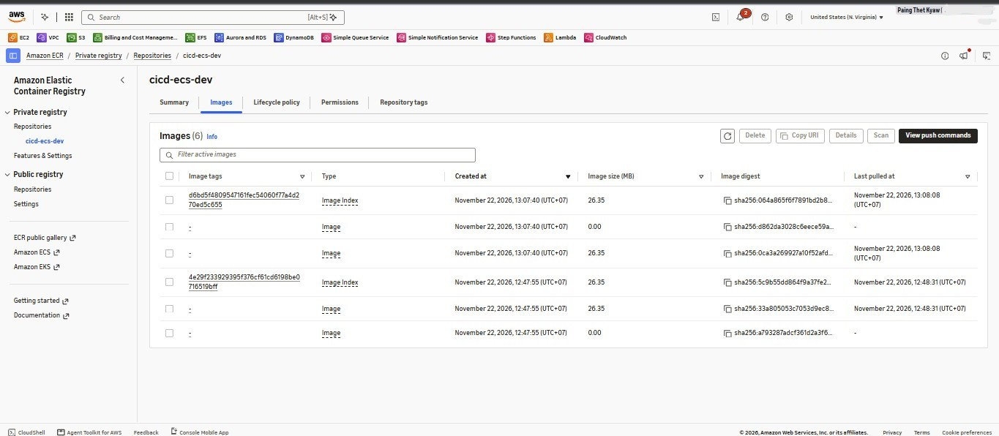
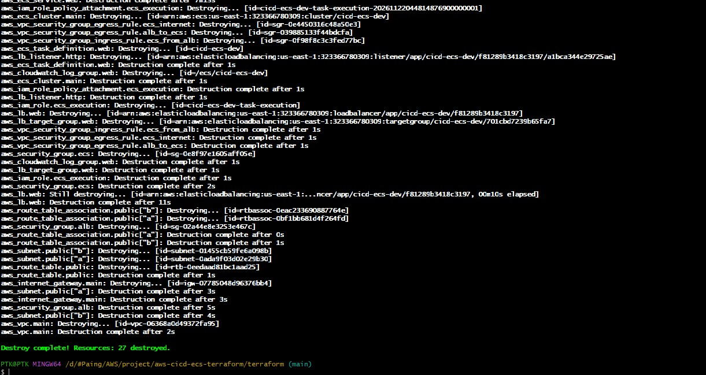

# AWS CI/CD Pipeline with ECS Fargate

## Project Overview & Architecture

A push to `main` that changes `app/` builds a lightweight Nginx Alpine image, tags it with the commit SHA, and pushes it to Amazon ECR. GitHub Actions then registers a new ECS task definition revision, deploys it to Fargate, and waits for the service to stabilize. An internet-facing Application Load Balancer (ALB) serves the application.

```text
GitHub push (main, app/**) or manual dispatch
                    |
                    v
             GitHub Actions -- OIDC --> AWS STS --> IAM deploy role
                    |
                    +-- build and push image by commit SHA --> Amazon ECR
                    |
                    +-- register task revision and update --> ECS service
                                                                  |
Browser --> Public ALB --> HTTP target group ----------------> Fargate task
                                                                  |
                                                               pulls image
                                                                  |
                                                              Amazon ECR

Terraform --> VPC, ALB, ECR, ECS, IAM/OIDC, and CloudWatch Logs
```

## Key Engineering Highlights

- **Keyless AWS authentication.** GitHub Actions exchanges its OIDC token for temporary AWS credentials. IAM checks the token audience and repository identity, then limits deployment permissions to the project's ECR repository, ECS service, and task execution role where AWS supports resource-level scoping.
- **Rolling deployments designed for zero downtime.** ECS can start a replacement task while the previous task continues serving traffic. The ALB checks `/` for target health, and the workflow waits for ECS service stability. [AWS ECS rolling deployment documentation](https://docs.aws.amazon.com/AmazonECS/latest/developerguide/deployment-type-ecs.html)
- **Infrastructure as code.** Terraform provisions the infrastructure in `us-east-1`. The demo runs one Fargate task with 256 CPU units and 512 MiB of memory in public subnets without a NAT gateway. The task security group accepts HTTP only from the ALB security group. Terraform ignores changes to the ECS service's task definition so CI/CD can manage application revisions.

## Real-World Troubleshooting

The workflow failed at `sts:AssumeRoleWithWebIdentity` with `AccessDenied`. AWS CloudTrail logs helped trace the failed role assumption and identify the mismatch between the IAM trust policy and GitHub's OIDC subject (`sub`). The policy expected a name-only repository subject, while GitHub sent its immutable format with numeric owner and repository IDs. The fix updated the `StringLike` condition in [`terraform/oidc.tf`](terraform/oidc.tf) to match the repository's actual subject prefix. [GitHub OIDC subject reference](https://docs.github.com/en/actions/reference/security/oidc#immutable-subject-claims)

```hcl
"token.actions.githubusercontent.com:sub" = "repo:paing-c@101639264/aws-cicd-ecs-terraform@1467224430:*"
```

## Project Structure

```text
.
|-- .github/
|   `-- workflows/
|       `-- deploy.yml    # Build, publish, and deploy
|-- app/
|   |-- Dockerfile        # Nginx Alpine image
|   `-- index.html        # Versioned sample page
|-- terraform/            # AWS infrastructure and outputs
|-- screenshots/          # Deployment and teardown evidence
`-- README.md
```

## Deployment Steps

1. **Provision AWS infrastructure.** From the repository root, use Terraform with AWS credentials authorized to create the resources. If you use a different GitHub repository, update the OIDC subject in `terraform/oidc.tf` to match that repository's token claims before applying.

   ```sh
   terraform -chdir=terraform init
   terraform -chdir=terraform plan
   terraform -chdir=terraform apply
   terraform -chdir=terraform output -raw github_actions_role_arn
   terraform -chdir=terraform output -raw alb_url
   ```

2. **Deploy the v1.0.0 baseline.** In GitHub, add the `github_actions_role_arn` output as the repository Actions secret `AWS_ROLE_ARN`. With `Version: v1.0.0` in `app/index.html` on `main`, run the **Deploy to Amazon ECS** workflow manually. After the run succeeds, open the `alb_url` output and confirm the badge shows `v1.0.0`.
3. **Verify the automated v2.0.0 rollout.** Change the badge to `v2.0.0` and push the app change to `main`. Confirm the workflow succeeds, then refresh the same ALB URL and check for `v2.0.0`.
4. **Tear down the demo.** Run the following from the repository root. The ECR repository is configured to delete its stored images during teardown.

   ```sh
   terraform -chdir=terraform destroy
   ```

## Proof of Work

### App V1



### App V2



### Github Actions Success



### ECS Cluster Service



### ECS Service Health



### ECS Task Definitions



### ALB Target Group Healthy



### IAM OIDC Trust Policy



### ECR Images



### Terraform Destroy


